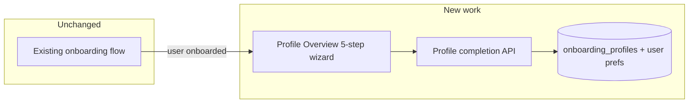

# Profile completion: five steps on Profile Overview (onboarding unchanged)

## Scope boundary (explicit)

- **Do not modify** onboarding: no changes to [`resources/js/pages/onboarding.tsx`](resources/js/pages/onboarding.tsx), [`OnboardingController`](app/Http/Controllers/OnboardingController.php) step flow, [`SaveStepRequest`](app/Http/Requests/Onboarding/SaveStepRequest.php), Stripe checkout order, or `complete()` validation beyond what already exists.
- **All product behavior** you specified (dump → clarify → goals → review → mentor, modes, completeness) lives in **profile editing / completion**, centered on [`profile-overview`](resources/js/pages/profile-overview.tsx) and **new** backend endpoints that read/write [`OnboardingProfile`](app/Models/OnboardingProfile.php) (and [`User`](app/Models/User.php) for mentor prefs).
- **Nudge to “complete your profile”**: implement via **dashboard** (and/or existing nav to Profile), e.g. banner when `profile_completeness_score` is low or a `profile_completion` flag shows steps unfinished — **not** by rebuilding onboarding.

## Current anchor

- [`ProfileOverviewController`](app/Http/Controllers/ProfileOverviewController.php) already loads `OnboardingProfile` and shapes `profile` + `ai` for read-only-style UI.
- Post-onboarding, users already have a profile row; completion wizard **extends** this page and adds **write** APIs.

---

## Data model

- Prefer **columns + JSON on `onboarding_profiles`** for extraction output, `profile_modes_json`, completeness callouts, and **profile completion cursor** (e.g. `profile_completion_step` or `profile_completion_state` JSON: `{ current_step, completed_steps[] }`).
- Avoid tying profile completion to **`onboarding_sessions` / `OnboardingResponse`** so the flow works months after signup; optional duplicate of “latest dump text” in `profile_dump_text` (text) if you need a source for re-extraction without re-reading onboarding responses.
- Migrations only touch `onboarding_profiles` / `users` as needed — **not** onboarding session tables for the wizard state.

---

## 1. Structured extraction (separate from No Cap)

- Add **`ProfilePasteExtractionAgent`** (`HasStructuredOutput`) with schema: extracted academics, activities, awards, goals, context, per-field **confidence**, derived hints (early grade, international, spike hypothesis).
- **Trigger**: Step 1 submit on Profile Overview → save dump text → run agent → store on profile (e.g. `extraction_draft_json` + `extraction_source_hash`).
- **No Cap** remains available for “admissions read” radar; optionally add a **profile-only** action to refresh `ai_context` after Step 4 using updated structured data (reuse patterns from [`ComposeAiContextFromOnboardingData`](app/Actions/Ai/ComposeAiContextFromOnboardingData.php) / job) **without** changing onboarding routes.

---

## 2. Step 1 — Dump (Profile Overview)

- Large textarea, placeholder copy, optional **PDF** upload + parser, optional **voice** → append to textarea.
- Empty submit: nudge copy (“Even just your GPA…”).
- PDF no text layer: set flag on profile; Step 2 shows full manual fields.

---

## 3. Step 2 — Clarification (dynamic, 3–6 fields)

- Service: **`DetermineClarificationFields`** from extraction + current profile columns.
- UI: form driven by server props; persist via **PATCH profile completion** endpoint.
- **`GpaNormalizer`**: raw + normalized storage per spec.

---

## 4. Step 3 — Goals and preferences

- Dream schools (max 5), majors (max 3), regions, campus size, aid slider, read-only timeline from grade.
- Persist to new/extended JSON columns; set **high-need aid** / **outside US** hints into `profile_modes_json`.

---

## 5. Step 4 — Spike + review + completeness

- Badge + one-liner (from extraction spike field and/or No Cap dimension if refreshed).
- Trajectory: only if data supports it.
- **Cards** with inline edit (PATCH partial updates).
- **`ProfileCompletenessCalculator`**: 0–100 + specific callouts → `profile_completeness_score` + callouts JSON.

---

## 6. Step 5 — Mentor setup

- Map to [`User::$ai_preferences`](app/Models/User.php) (tone, nudges, parent access, mood check-ins); static **preview** lines by tone; align enums with [`settings/ai`](resources/js/pages/settings/ai.tsx).

---

## 7. Cross-cutting modes

- Store **`profile_modes_json`** (early student, international, high-need aid, no-test, low completeness, spike).
- Share via [`HandleInertiaRequests`](app/Http/Middleware/HandleInertiaRequests.php) for **dashboard** / **essay suite** — no onboarding involvement.

---

## 8. Testing

- Feature tests: profile completion API auth, step transitions, validation.
- Unit tests: normalizer, completeness, clarification resolver.

---

## Implementation order

1. Migration + model fillable/casts for new profile fields and completion state.
2. Extraction agent + Step 1 API + Profile Overview Step 1 UI.
3. Step 2–3 APIs + UI.
4. Step 4 cards + completeness + optional ai_context refresh.
5. Step 5 mentor prefs + dashboard nudge.
6. PDF + voice + tests.

This matches your spec while keeping the **existing onboarding path frozen** and making **Profile Overview** the place where “everything is added” for structured completion.
