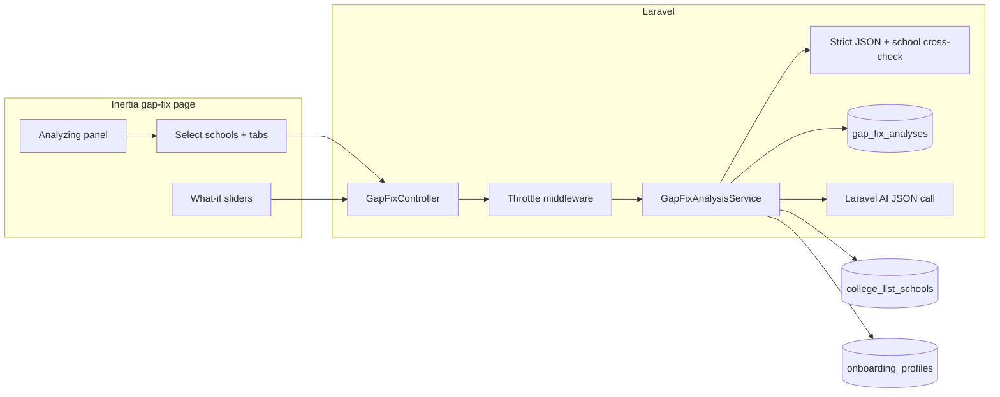

# Gap + Fix Engine (MVP slice)

## Current state

- [todo.md](todo.md) §2.4 lists all three items as **To Do**; [routes/web.php](routes/web.php) has **no** gap/fix routes (unlike [essay-suite](routes/web.php) / college-lists).
- Strong **inputs** already exist:
  - [app/Models/CollegeListSchool.php](app/Models/CollegeListSchool.php): `tier`, `fit_score`, `acceptance_rate`, `median_gpa`, `median_sat`, `median_act`, `why_blurb`, deadlines, aid band, etc.
  - [app/Models/OnboardingProfile.php](app/Models/OnboardingProfile.php): `current_grade`, `graduation_year`, `gpa_normalized_4`, `sat_score`, `act_score`, `test_optional_status`, `ai_context`, spike/activities JSON — enough for **timeline-aware** copy in prompts.
- [app/Ai/Tools/GetStudentAdmissionContextTool.php](app/Ai/Tools/GetStudentAdmissionContextTool.php) already assembles the right snapshot for tools; the new feature should **reuse the same facts** (extract a small shared builder or call into the same shape) rather than duplicating query logic.

## Product shape (matches your table + [mvp.md](mvp.md) §3)

Ship **one page** with three clear regions (tabs or stacked sections):

| Area | MVP behavior |
|------|----------------|
| **Rejection risk** | For **selected list schools** (multi-select from active `college_list_schools`), show **top 3 plain-English reasons** each — narrative + optional severity tag, grounded in profile vs school medians/tier/fit. |
| **Gap scoring & fix roadmap** | One **cross-profile** list of gaps: `critical` / `moderate` / `minor`, sorted; each gap has **3–6 concrete steps** (programs, retest timeline, list edits) — not generic fluff. |
| **What-if simulator** | **Client-side sliders** (e.g. SAT +/−, GPA +/− small deltas) that recompute **deterministic signals** vs selected schools’ `median_*` / tier (e.g. “now within median band for 2 reaches”) plus a **short “Explain impact”** button that calls the backend with the hypothetical numbers for one LLM paragraph (keeps cost bounded). |

This satisfies the todo rows without three separate URLs; you can split routes later if needed.

## Day-one hard requirement: throttling (expensive endpoint)

**Regenerate / Run analysis is a high-cost, high-abuse surface** (LLM + multi-school JSON). Throttling is **not** an afterthought; it ships with the first route and is covered by tests.

- Apply **dedicated middleware** on `POST …/gap-fix/generate` (and on any `POST …/gap-fix/what-if` that invokes an LLM), with limits **stricter** than lightweight endpoints (do not default to “same as essay run” without review).
- Recommended starting point (tune in `config/`): **per-user** limit such as **3–5 generations per hour** (and a lower burst per minute if needed), plus optional **per-IP** cap for unauthenticated edge cases (should not apply once authed-only).
- Return **429** with a clear JSON/Inertia-friendly message (“Try again in X minutes”) so the UI can show a non-broken state.
- **Document the chosen limits** in a code comment next to the route and in config so future changes are intentional.

## Strict AI output contract: validation, retry, partial, never silent gaps

After each model response:

1. **Parse + schema-validate** the decoded JSON (required top-level keys, types, array shapes, allowed `severity` enum, minimum lengths where applicable).
2. **Cross-check `rejection_risks`**: every **selected** school id must appear **exactly once** with **three** non-empty reason strings. If any selected school is missing, duplicated, or short on reasons, the payload is **incomplete** — do not treat as success silently.
3. **Recovery path**:
   - **One automatic retry** (second call with a short system addendum: “previous output failed validation: …”) when validation fails or JSON is malformed.
   - If still invalid after retry: return **422** (or 200 with `analysis_status: failed` and error detail — pick one convention and use it consistently) and **do not overwrite** the last good stored analysis with garbage.
4. **Partial mode** (if product accepts degraded delivery): only if you explicitly define it — e.g. show **only** schools that validated and a **persistent banner**: “Partial results: we couldn’t complete analysis for Harvard and MIT. Regenerate or pick fewer schools.” Never render cards that look complete when data is partial.

Persist to `gap_fix_analyses` only **validated** payloads, or payloads **explicitly marked** `partial: true` with `missing_school_ids[]` for audit — never a silent half-empty UI.

## Analysis in progress: intentional loading UX (8–15s)

A multi-school structured JSON call can take **8–15 seconds**. That wait is part of the product: it should feel **earned**, not like a broken page.

- **Do not** use a lone generic spinner on an empty content area.
- **Do** show a dedicated **“Analyzing”** panel while the request is in flight (or while polling a queued job, if you choose async):
  - Copy that names **N selected schools** and that you are comparing **their saved profile** (and timeline where relevant) to each school’s list data.
  - Optional **staged microcopy** (e.g. rotating lines or a short checklist: profile → schools → risks → roadmap) so time passes with a sense of progress — without faking false completion percentages.
- If implementation is **synchronous** `fetch`/`router.post`: disable Regenerate during the request and keep the panel visible until resolve/reject.
- If implementation is **queued job + poll**: reuse the same panel during `queued`/`processing` states until the stored row is ready — same UX contract.

## Backend plan

1. **Route + controller** (middleware: `auth`, `onboarded`, `verified`, `platform.access` — same group as essay suite):
   - `GET /gap-fix` → Inertia page props: active schools (id, name, tier, medians, fit), latest saved analysis (if any), profile summary fields needed for UI labels.
   - `POST /gap-fix/generate` → throttle middleware + service (validation/retry/persist rules above).
2. **Service** `App\Services\GapFix\GapFixAnalysisService` (name flexible):
   - Build payload: user + `OnboardingProfile` + selected `CollegeListSchool` rows (validate IDs belong to user).
   - Call Laravel AI with a **documented JSON contract**; enforce **strict post-validation** and rules in the previous section.
   - Include in system/developer instructions: **timeline** (`current_grade` / `graduation_year`), **test-optional** flag, and “do not invent statistics not in payload.”
3. **Persistence (recommended)**  
   - New table e.g. `gap_fix_analyses`: `user_id`, `selected_school_ids` (json), `payload` (json), optional `status` / `is_partial`, `created_at` — latest row powers the page; **Regenerate** creates a new row.  
   - Alternative (lighter): JSON column on `users` — worse for history/versioning.

## Frontend plan

- New page [resources/js/pages/gap-fix.tsx](resources/js/pages/gap-fix.tsx) (or `gap-fix/index.tsx`): school multi-select, “Run / Regenerate analysis”, **analyzing experience** (section above), **partial-results banner** when applicable, three panels rendering structured data (reuse [resources/js/components/markdown/prose-markdown.tsx](resources/js/components/markdown/prose-markdown.tsx) only where copy is markdown; default is cards/lists).
- **What-if**: controlled inputs + derived metrics component; POST `gap-fix/what-if` with `{ sat_delta, gpa_delta }` returning `{ metrics, narrative? }` or compute metrics only in TS and optional narrative endpoint — **throttle** any LLM-backed explain separately.
- **Navigation**: add link in [resources/js/components/workspace-sidebar-nav.tsx](resources/js/components/workspace-sidebar-nav.tsx) (and Wayfinder route stub if the project uses generated routes — mirror [essay-suite](routes/web.php) pattern).

## Testing & safety

- **Feature tests**: auth; empty list CTA; **429 when throttle exceeded**; malformed / incomplete AI response → **retry then 422 or explicit failure payload**; partial path shows `missing_school_ids` when implemented; happy-path persistence with faked AI.
- **Empty states**: no schools on list → CTA link to [college-lists](routes/web.php).

## Out of scope for this MVP slice (explicit)

- Full “admissions outcome database” or calibrated probability models.
- Per-school saved history beyond “latest analysis” (unless you add multiple rows UI later).

## Dependency diagram

